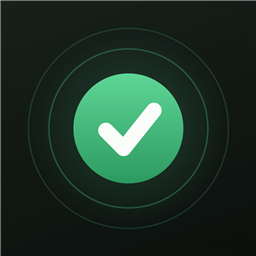
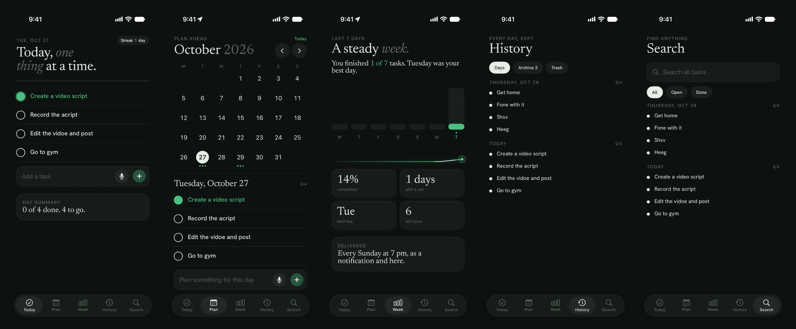
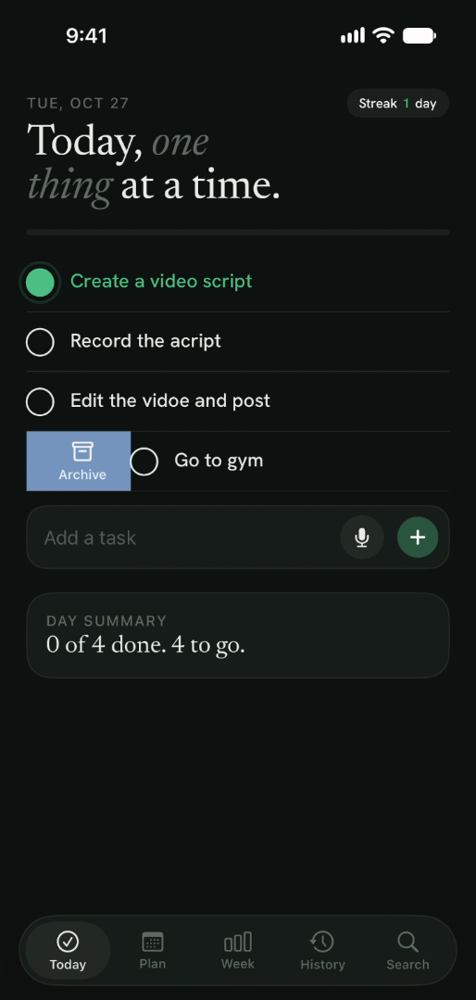
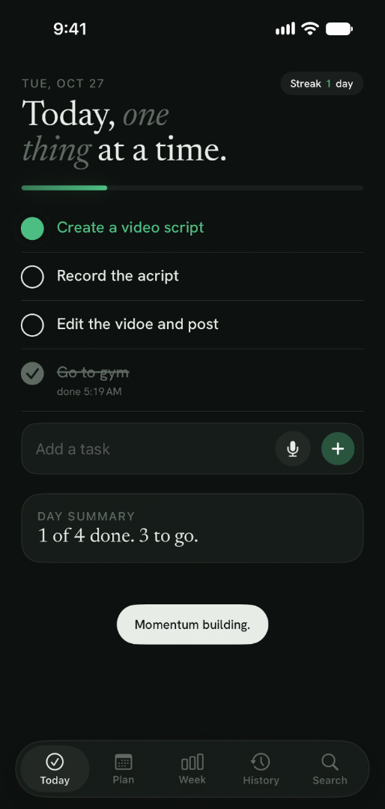

<p align="center">
  
</p>

<h1 align="center">Stillday</h1>

<p align="center">
  A calm daily task app for iPhone. One thing at a time, every day kept, a summary every week.
</p>

<p align="center">
  
</p>

## What it does

- **Today.** Your tasks for the day. The first unfinished task is green, finished ones are grey, the rest are black. A streak chip, a pulsing progress bar and a day summary sit around the list.
- **Finish with a flourish.** Tapping a bullet draws the check, sweeps a strike-through across the title, bursts a ring of particles, plays a system sound and gives a light haptic. Clearing the whole day gets a bigger burst and bumps the streak.
- **Swipe.** Slide a task right to archive it, left to move it to Trash. The colour fades in as you drag, and an Undo toast appears.
- **Archive and Trash.** Both live in History. Slide right to pull a task back, left to delete it for good. Trash empties itself after 30 days.
- **Plan.** A month calendar with a dot for every planned task. Tap a day to see or add its tasks.
- **Week.** Seven-day bars, a trend line that draws itself, and four numbers: completed, days with a win, best day, tasks still open.
- **History and Search.** Every day is kept. Search by text and filter by Open or Done.
- **Voice.** Tap the mic, say "call the dentist, send the invoice and read for twenty minutes", check the three tasks it found, and add them.
- **Nudges.** Local notifications are re-planned every time you change a task: morning, midday, evening, a 9 pm streak-saver and a Sunday recap. They are capped at four a day, with quiet hours at night, and they are cancelled for a day you have cleared.

<p align="center">
  
  &nbsp;
  
</p>

## Design

Sage-tinted off-white and deep forest ink, with a single green that always means "this is next". Titles are set in [Newsreader](https://fonts.google.com/specimen/Newsreader) and everything else in [Hanken Grotesk](https://fonts.google.com/specimen/Hanken+Grotesk). Both are bundled in the app and are open-source (SIL Open Font License). Light and dark themes follow the phone.

## Built with

- Swift 6 and SwiftUI, targeting iOS 17
- A plain JSON file for storage, so there is no account, no server and no network use
- Apple's Speech framework for voice, using on-device recognition when the phone supports it
- UserNotifications for the nudges, and AudioToolbox for the built-in system sounds
- [xtool](https://github.com/xtool-org/xtool) to build, sign and install from Windows without Xcode

## Project layout

```
Stillday/
  Package.swift        SwiftPM package (one library product, as xtool expects)
  xtool.yml            bundle ID, app icon, bundled fonts, Info.plist
  Info.plist           microphone and speech permission text, display name
  Resources/           AppIcon.png and the five font files
  Sources/Stillday/
    StilldayApp.swift  app entry, tab bar, toast
    Store.swift        tasks, streak, week numbers, JSON persistence
    TodayView.swift    Today list, bullets, burst, progress pulse
    PlanView.swift     month calendar and the day's list
    WeekView.swift     bars, trend line, stats
    HistorySearch.swift  History, Archive, Trash, Search
    Swipe.swift        swipe-to-archive and swipe-to-trash row
    Voice.swift        speech capture, sentence splitter, review sheet
    Notifier.swift     local notification planning
    Sound.swift        system sound IDs
    Theme.swift        colours and fonts
docs/                  screenshots used in this page
```

## Build and install

The app is built with xtool, so a Mac is not required. On Windows, run these inside WSL (Ubuntu):

1. Install the Swift toolchain and xtool, then run `xtool setup` once. It asks for your Apple ID and for an `Xcode.xip` download, from which it extracts the iOS SDK.
2. Plug in the iPhone and make sure WSL can see it, for example with [usbipd](https://learn.microsoft.com/windows/wsl/connect-usb).
3. From the `Stillday` folder:

```bash
xtool dev build            # compile only
xtool dev                  # build, sign and install on the connected iPhone
xtool dev build --sign --ipa   # signed Stillday.ipa you can install with another tool
```

On a Mac or Linux the same commands work without WSL.

### Things to know

- A free Apple ID signs apps for **7 days**. After that the app stops opening until you reinstall it. A paid Apple Developer account removes the limit.
- The first launch asks for notification, microphone and speech permissions. Voice and nudges only work if you allow them.
- System sound IDs are not documented by Apple, so a sound can differ or be silent on some iOS versions.
- All data stays on the phone. Deleting the app deletes the tasks.

## Status

A personal project, in active use on an iPhone. It is not on the App Store.
